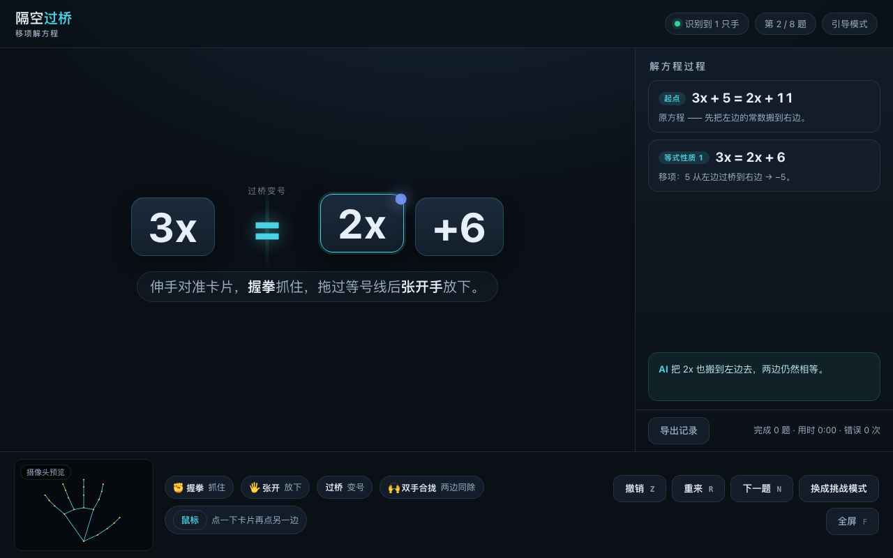

# 隔空过桥 · 移项解方程（手势操作型课堂教具）

> 学生站在屏幕前，**用手把项"搬"过等号** —— 搬过去必须变号，等式两边实时保持相等。
> 单页纯静态网页，识别引擎与模型全部本地化，**断网也能跑**。



---

## 一、为什么是"移项"

解一元一次方程，学生最高频、最致命的错误是**移项忘记变号**。
文字口诀是抽象的；"把项从等号一边搬到另一边"是一个可以**用身体做出来**的动作。

这个页面把等式性质 1 变成一次搬运：**卡片越过等号线 → 符号翻转**，天平（等号）保持平稳。
身体记住了，口诀就只是给这个动作配的一句话。

---

## 二、怎么跑

**必须用本地静态服务器打开**（ES 模块 + WebAssembly + 摄像头权限都不支持 `file://`）：

```bash
cd /Users/fjchen/Documents/AInetwork
python3 server.py 8080
# 浏览器打开 http://127.0.0.1:8080/gesture/gesture-bridge/
```

点「允许摄像头并开始」，几秒内即可就绪。识别引擎（`lib/`）与模型（`model/`）
都放在本地，**不联网也能跑**。

### 四个辅助入口

| 地址 | 作用 |
|---|---|
| `?demo=1` | **彩排模式**：不调用摄像头，用脚本手势自动演示整套流程，课前试讲用 |
| `?selftest=1` | **方程引擎自检**：断言移项变号、等价校验、同除、随机题目生成 |
| `?autotest=1` | **交互链路自测**：用假时钟驱动"抓取→过桥→变号→合并→同除→解出" |
| `?shot=1` | 摆一个固定画面，用于生成 `previews/gesture-bridge.png` |

---

## 三、手势与操作

| 手势 | 屏幕上发生什么 |
|---|---|
| **手掌对准卡片** | 卡片浮起、发光（目标够大，不要求指尖精确） |
| **✊ 握拳**（连续 4 帧） | 抓住卡片，卡片跟手，出现拖尾 |
| **把卡片拖过等号线** | 等号线亮起、出现"过桥变号"提示 |
| **🖐 张开手**（连续 4 帧） | 放下：符号翻转 `+5 → −5`，右侧板书追加一行 |
| **🙌 双手合拢**（两掌心距收到很近） | 两边同除以系数（等式性质 2），用于 `2x = −8` 这种最后一步 |

> 取卡片 → 握拳 → 过桥 → 张开，这四拍就是一个完整的"移项"。
> 每次动作后需把手张开再握拳，防止上一个动作连着触发下一个。

### 三种输入，任一套都能上完整一节课

| 方式 | 操作 |
|---|---|
| 手势 | 见上表 |
| 鼠标 | 点一下卡片选中，再点舞台左半 / 右半放下 |
| 键盘 | `Tab` 聚焦卡片 → `Enter` 选中 → `←` / `→` 移过去；`Z` 撤销、`R` 重来、`N` 下一题、`M` 切模式、`F` 全屏 |

---

## 四、课堂怎么用（约 8 分钟）

1. **出题**：投出 `3x + 5 = 2x + 11`，问"下一步做什么？"
2. **学生上台**：伸手 → 光标出现 → 对准 `+5` → 握拳抓住。
3. **过桥**：把卡片拖过等号线，张开手 → `+5` 翻成 `−5` 落到右边，板书追加一行。
4. **追问**：为什么能变号？点开右侧「等式性质 1」那一条 → 讲"两边同减 5"。
5. **故意犯错**（挑战模式）：同样拖过桥，但比 2 指"不变号" → 等号抖、卡片红闪 → AI 说"移项必须变号"。
6. **收尾**：`3x = 2x + 6` → 再把 `2x` 搬过去 → `x = 6`；
   遇到 `2x = −8` 就**双手合拢**，演示"两边同除以 2"。
7. **复盘**：点「导出记录」下载本题每一步的 CSV。

### 两种模式

| 模式 | 行为 | 适用 |
|---|---|---|
| **引导模式**（默认） | 过桥后系统自动变号 | 老师讲解、第一次演示 |
| **挑战模式** | 过桥后先问"符号要变吗？"（1 指 = 变号，2 指 = 不变） | 学生练习；答错会看到等式真的歪掉，再自动撤销 |

---

## 五、题目

内置 8 道题（每次刷新重新生成，保证整数解）：

| 关卡 | 题型 | 例题 |
|---|---|---|
| L1 单移项 | 常数过桥 | `x − 3 = 3` |
| L2 双移项 | 两边都有未知数 | `3x + 5 = 2x + 11` |
| L3 移项+合并 | 移项后合并同类项 | `5x − 3 = 2x + 9` |
| L4 系数化为 1 | 双手合拢同除 | `2x = −8` |

**判题不写死步骤**：每一步都用 5 个随机 `x` 值代入，检查变换前后"左右两边之差"是否一致
（`isEquivalent`）。所以哪怕学生用非常规顺序解，只要每一步等价就放行。

---

## 六、可调参数

`index.html` 顶部 `CONFIG`：

```js
MAX_HANDS: 2,           // 同时识别的手数
OPEN_FINGERS: 4,        // 张开几根手指算"松手"
FIST_FRAMES: 4,         // 握拳连续多少帧才真正抓住
OPEN_FRAMES: 4,         // 张开连续多少帧才真正放下
HOVER_PAD: 12,          // 卡片命中判定的外扩像素（越大越宽容）
COOLDOWN_MS: 520,       // 放下后多久内不许再抓
CURSOR_GAIN: 1.18,      // 手在画面里的移动放大到屏幕的比例
SMOOTH: 0.34,           // 光标平滑（越小越稳、越滞后）
TWO_HAND_GAP: 0.16,     // 两掌心距小于舞台短边的多少算"合拢"
```

**识别不灵敏时先调这三个**：

- 手明明张开了却没放下 → 把 `OPEN_FINGERS` 调成 `3`
- 手一晃就误抓 → 把 `FIST_FRAMES` 调到 `6`、`COOLDOWN_MS` 调到 `700`
- 手不够大就抓不到卡片 → 把 `HOVER_PAD` 调到 `20`，或离摄像头近一点

---

## 七、排查

| 现象 | 原因与处理 |
|---|---|
| 一直显示「识别到 0 只手」 | 手掌没正对镜头 / 光线太暗 / 逆光 / 手太小 / 摄像头被别的软件占用 |
| 提示"请把手掌正对摄像头" | 跑满约 9 秒仍没识别到手，按上面几条检查 |
| 光标抖 | 光线不均匀（顶光、逆光）；把 `SMOOTH` 调小到 `0.25` |
| 卡片跟着手但放不下 | 张开手掌要**五指张开**；可把 `OPEN_FINGERS` 调到 `3` |
| 挑战模式比了手指没反应 | 手要先从张开的姿势收回来再比 1/2 指，且保持约 0.1 秒 |
| 页面打不开 / 摄像头没权限 | 必须 `http://127.0.0.1` 或 `https`，不能双击 `file://` |

---

## 八、现场彩排要点

1. **机位**：摄像头在屏幕上方，学生站屏幕侧前方比划 —— 手不会挡住投影画面。
2. **光线**：正面柔和照明，避免强逆光 / 顶光；投影白屏本身反光时把学生往侧面挪半步。
3. **距离**：手掌占画面 1/5 以上识别最稳；太远会抓不住卡片。
4. **先彩排**：课前用 `?demo=1` 跑一遍，确认投影分辨率下卡片字号够大。
5. **兜底**：学生手势一直不成功，直接用鼠标点一下卡片、再点另一边 —— 课堂不卡壳。
6. **多人入镜**：只认画面里最大（离镜头最近）的那只手做操作手，其他人只显示不参与判定。

---

## 九、文件结构

```
gesture/gesture-bridge/
├── index.html               # 页面本体（单文件逻辑）
├── README.md
├── PLAN.md                  # 策划案（设计取舍、备选方案）
├── lib/                     # 从 gesture-demo 复制的识别引擎（ES 模块 + wasm）
│   ├── vision_bundle.js
│   └── wasm/
└── model/
    └── hand_landmarker.task # 手部关键点模型（约 7.8MB）
```

`lib/` 与 `model/` 和 `gesture-demo` / `gesture-edu` 是**同一份引擎**，
升级时三处要一起替换（引擎与 wasm 版本必须一致）。

---

## 十、和其它三个手势页的区别

| 页面 | 手势原语 | 交互范式 |
|---|---|---|
| 空中画函数 | 指尖轨迹、双手对碰 | 脚本化舞台演示 |
| 手势课堂反馈 | 手指数 1~4 | 离散选择 + 统计 |
| 手势数独 | 指尖光标 + 捏合 | 精细点选 |
| **隔空过桥** | **抓取 + 跨越 + 双手合拢** | **空间搬运（过桥变号）** |

本页刻意反着"精细操作"来设计：判定事件是"卡片越过中线"这个**大空间事件**，
不要求精确落点、系统自动重排，容错高，课堂不容易卡。

---

## 十一、自检

```bash
# 方程引擎（不启动摄像头）
open "http://127.0.0.1:8080/gesture/gesture-bridge/index.html?selftest=1"

# 交互链路（假时钟，跑 4 道题）
open "http://127.0.0.1:8080/gesture/gesture-bridge/index.html?autotest=1"

# 全站自检（含本页的 JS 报错检查）
bash tools/verify.sh
```
